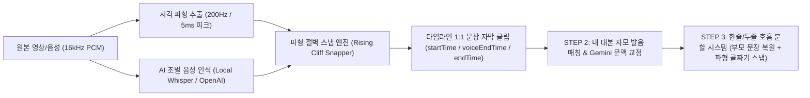

# 🎬 Antigravity Video Edit — 기능 명세, 방향성 및 문제 해결 현황

> **작성일**: 2026-10-31  
> **프로젝트 경로**: `c:\Users\PC\Documents\video-edit`

---

## 1. 프로젝트 핵심 방향성 (Vision & Architecture Direction)

### 🎯 지향점: "파형(물리 신호) 기준 100% 칼싱크 + 대본/AI 문맥 교정의 완벽한 분리"
본 프로젝트(**Antigravity Video Edit**)는 한국어 숏폼(릴스·쇼츠·틱톡) 및 유튜브 영상 편집에서 가장 많은 시간이 소요되는 **자막 싱크 맞추기, 대본 오타 교정, 한 줄/두 줄 호흡 분할, 무음 컷 편집**을 자동화하는 데스크톱 NLE(비선형 영상 편집기)입니다.

1. **초록색 오디오 파형이 곧 절대 기준 (Waveform as Single Source of Truth)**
   - AI 모델(Whisper, Gemini 등)이 추론한 타임스탬프는 모델 특성상 `±0.2초 ~ 0.5초`의 오차가 반드시 발생합니다.
   - 따라서 AI는 **"어느 시간대 근처에서 무슨 말을 했는가"**만 알려주는 가이드로만 사용하고, 실제 자막 클립이 시작되고 끝나는 시간은 타임라인에 그려지는 **200Hz(5ms 단위) 초록색 오디오 파형의 무음 골짜기(Silence Valley) 직후 파형이 솟구치는 절벽(Rising Cliff)**에 물리적으로 고정합니다.
2. **타이밍(Timing)과 텍스트(Text)의 완전 분리**
   - 대본 교정(STEP 2)이나 상위 AI 모델(Gemini)을 거치더라도 **이미 파형에 맞춰진 자막 상자의 시작/종료 타이밍은 절대 흔들리지 않으며**, 상자 안의 글자(오타, 띄어쓰기, 고유명사)만 내 대본과 일치하도록 교정합니다.
3. **비파괴적(Non-Destructive) 자막 줄바꿈 재구성**
   - 「캡션 한줄 / 두줄 이내 변환 시스템」을 통해 언제든 1줄 자막 ↔ 2줄 자막, 글자 수(`7자 ~ 24자`)를 바꾸더라도, 원래 부모 문장(`sentenceGroupId`)의 전체 발화 구간(`startTime ~ voiceEndTime`)을 기준으로 재계산하여 몇 번을 반복 실행해도 싱크가 무너지지 않도록 설계합니다.

---

## 2. 현재 구현된 주요 기능 (Implemented Features)

### ① 멀티트랙 타임라인 & 시퀀스 편집 시스템
- **관련 파일**: [`src/components/TimelinePanel.tsx`](file:///c:/Users/PC/Documents/video-edit/src/components/TimelinePanel.tsx), [`src/store/useEditorStore.ts`](file:///c:/Users/PC/Documents/video-edit/src/store/useEditorStore.ts), [`src/components/AudioWaveformCanvas.tsx`](file:///c:/Users/PC/Documents/video-edit/src/components/AudioWaveformCanvas.tsx)
- **다중 트랙 지원**: 비디오(`V1~V3+`), 오디오(`A1~A3+`), 캡션/자막(`C1+`) 트랙 추가/삭제, 트랙별 잠금(Lock)·뮤트(Mute)·솔로(Solo)·가시성(Visible) 제어.
- **멀티 시퀀스 & 원본 자동 맞춤**: 미디어를 타임라인에 드래그 앤 드롭하면 원본 영상의 해상도(`1080×1920` 세로 숏폼, `1920×1080` 가로 롱폼 등)와 FPS를 자동 감지하여 시퀀스를 생성하며, 하단 프로젝트 패널에서 여러 시퀀스를 탭으로 전환하며 작업 가능.
- **200Hz(5ms) 고정밀 초록색 오디오 파형 & 실시간 VU 미터**: FFmpeg PCM 추출을 통해 타임라인 확대를 최대로 해도 깨지지 않는 5ms 해상도의 초록색 파형 렌더링 및 재생 중 실시간 오디오 레벨 미터([`src/components/AudioVuMeter.tsx`](file:///c:/Users/PC/Documents/video-edit/src/components/AudioVuMeter.tsx)) 제공.
- **전문 컷 편집 도구**:
  - 선택 도구(`V`) 및 면도칼 분할 도구(`C` / `Ctrl+K`)
  - 다중 클립 선택·동시 이동, 드래그 트림 시 겹치는 하위 클립 자동 덮어쓰기(Overwrite)
  - 비디오-오디오 링크 연결/해제(`Unlink`)
  - **빈 공간 일괄 닫기(`Ripple Close Gaps`)**: 모든 트랙이 동시에 비어 있는 순수 공백만 계산하여 V/A 싱크 어긋남 없이 앞당김

### ② 3단계 AI 자막·대본 자동화 시스템
- **관련 파일**: [`src/components/LeftSidebar.tsx`](file:///c:/Users/PC/Documents/video-edit/src/components/LeftSidebar.tsx), [`src/utils/localWhisper.ts`](file:///c:/Users/PC/Documents/video-edit/src/utils/localWhisper.ts), [`src/utils/scriptAligner.ts`](file:///c:/Users/PC/Documents/video-edit/src/utils/scriptAligner.ts), [`src/utils/geminiAligner.ts`](file:///c:/Users/PC/Documents/video-edit/src/utils/geminiAligner.ts)
- **[STEP 1] AI 초벌 캡션 생성**:
  - **로컬 무료 Whisper**(`whisper-base`, `whisper-small`, `whisper-tiny` — API 키 없이 내 PC에서 무제한 구동), **OpenAI Whisper API**, **Google Gemini 하이브리드 엔진**(`gemini-3.8-flash` 등 + 할당량 초과 시 하위 모델 자동 폴백) 지원.
  - 음성 인식 직후 [`snapSegmentToVisualWaveform`](file:///c:/Users/PC/Documents/video-edit/src/utils/localWhisper.ts#L100-L265)을 통해 각 문장의 시작점을 초록색 파형 절벽에 5ms 단위로 스냅하고, 문장 사이 묵음 구간은 다음 문장 시작 직전(`0.000초` 간격)까지 자동 연장(Gap-Bridging).
- **[STEP 2] 내 대본 비교 오타 변환 & 줄바꿈 직접 적용**:
  - **오타·띄어쓰기만 변환 모드**: [`compareAndCorrectCaptionsWithScript`](file:///c:/Users/PC/Documents/video-edit/src/utils/scriptAligner.ts)가 한글 초·중·종성 자모 발음 유사도(Phonetic Similarity)를 분석하여, 파형에 고정된 자막 클립의 시간은 건드리지 않고 글자만 내 대본으로 100% 교정.
  - **내 대본 줄바꿈(Enter) 그대로 적용 모드**: [`alignScriptLinesToExistingCaptions`](file:///c:/Users/PC/Documents/video-edit/src/utils/scriptAligner.ts#L1138-L1562)가 대본 입력창의 각 줄을 개별 자막 클립 1개씩으로 매칭.
- **[STEP 3] 캡션 한줄 / 두줄 이내 변환 시스템 & 프리뷰 단축키 분할**:
  - **`[한 줄로 나뉘게 (1줄 고정)]` / `[화면 두 줄 이내로 (최대 2줄)]`**: 한국어 조사·어미·의존명사(`~까 봐`, `~해서`, `~는데`, `수/것/등`)가 어색하게 찢어지지 않도록 의미·호흡 단위로 자동 분할.
  - **프리뷰 모니터 직접 분할/합치기**: 중앙 영상 프리뷰 화면([`src/components/PreviewPlayer.tsx`](file:///c:/Users/PC/Documents/video-edit/src/components/PreviewPlayer.tsx))의 자막 텍스트 위에서 원하는 글자 사이를 클릭하고 `Enter`를 누르면 즉시 자막 클립이 2개로 나뉘고, `Backspace`를 누르면 앞 자막과 즉시 하나로 병합.

### ③ 무음 구간 자동 컷 편집 (Auto Silence Cut)
- **관련 파일**: [`electron/main.ts`](file:///c:/Users/PC/Documents/video-edit/electron/main.ts), [`src/components/LeftSidebar.tsx`](file:///c:/Users/PC/Documents/video-edit/src/components/LeftSidebar.tsx)
- 기준 데시벨(`-50dB ~ -18dB`), 최소 무음 길이(`0.15초 ~ 2.0초`), 앞뒤 여유 패딩(`0 ~ 250ms`)을 조절하여 오디오의 숨소리/침묵 구간만 골라내고 비디오+오디오 트랙을 동시에 분할 및 리플 밀착 연결.

### ④ 자막 디자인 인스펙터 & 전체 스타일 동기화
- **관련 파일**: [`src/components/RightInspector.tsx`](file:///c:/Users/PC/Documents/video-edit/src/components/RightInspector.tsx)
- 폰트 패밀리, 크기, 굵기, 기울임, 자간, 텍스트 색상/투명도, 외곽선(두께·색상), 그림자(블러·오프셋·색상), 배경 박스(색상·투명도·모서리 둥글기·X/Y 패딩), 화면 위치(X/Y %) 설정 및 **시퀀스 내 모든 자막에 스타일 자동 동기화 / 1클릭 일괄 적용**.

### ⑤ 프로젝트 관리(`.agproj`) 및 FFmpeg MP4/SRT 렌더링
- **관련 파일**: [`src/components/TopHeader.tsx`](file:///c:/Users/PC/Documents/video-edit/src/components/TopHeader.tsx), [`src/components/RelinkMediaModal.tsx`](file:///c:/Users/PC/Documents/video-edit/src/components/RelinkMediaModal.tsx), [`electron/main.ts`](file:///c:/Users/PC/Documents/video-edit/electron/main.ts)
- 프로젝트 파일(`.agproj`) 저장·불러오기·다른 이름으로 저장, 최근 프로젝트 목록, 로컬 스토리지 자동 백업, 원본 미디어 위치 변경 시 일괄 재연결(Relink Media), FFmpeg 기반 최종 MP4 영상 출력 및 SRT/TXT 자막 파일 내보내기.

---

## 3. 현재 추가·고도화하려는 기능 (Upcoming Roadmap)

1. **한줄/두줄 변환 시스템의 음절별 정밀 파형 정렬 고도화 (진행 중)**
   - 문장 내부를 한 줄씩 나눌 때, 단순 글자 수 비례를 넘어 문장 내부의 미세 숨구멍(Micro-Pause)과 한국어 음절 발화 가중치(한글·숫자·문장부호 휴지기)를 결합해 **문장 중간에서 나뉘는 1줄 자막도 초록색 파형 봉우리 시작점과 정확히 일치**하도록 정밀화.
2. **AI 멀티모달 디렉터 (Gemini Multimodal Audio/Video Director) 확장**
   - **NG 컷 / 말실수 / 중복 발화 자동 감지**: 동일 문장을 다시 말한 구간이나 불필요한 추임새("어...", "음...")를 AI가 찾아내어 원클릭 제거 추천.
   - **핵심 키워드 하이라이트 자막 자동화**: 숏폼 후킹 구간(첫 3초)이나 핵심 단어만 다른 색상/크기로 강조 표시하는 기능.
   - **자막 클립 드래그 시 파형 절벽 마그네틱 스냅**: 사용자가 타임라인에서 자막 클립 가장자리를 마우스로 직접 조절할 때도 오디오 트랙의 초록색 파형 시작 절벽(`Rising Cliff`)에 자석처럼 달라붙는 UI 스냅 보조 기능.

---

## 4. 발생했던 핵심 문제들과 해결 현황 (Issues & Solutions)

| 구분 | 발생한 문제 현상 | 근본 원인 분석 (Root Cause) | 해결 방식 및 현재 상태 |
| :--- | :--- | :--- | :--- |
| **문제 1** | **자막 시작점이 타임라인 초록색 파형 시작점과 어긋나고 자꾸 뒤로 밀리는 현상** (Gemini 상위 모델을 써도 동일하게 발생) | 1) AI 모델(Whisper/Gemini)의 추론 타임스탬프 자체에 `0.2~0.5초` 오차가 존재함. 2) 기존 15ms 에너지 필터(`sustainedVoiceBeforeSilence < 16`)가 `"이건"`(`225ms`)처럼 짧은 첫 단어를 숨소리로 오판해 건너뛰었음. 3) 인접 자막 사이에 `-1프레임(0.033s)` 공백을 강제로 빼서 파란 재생선(Playhead) 위치에서 자막이 늦게 뜨거나 깜빡였음. | **[해결 완료]** - 타임라인 렌더러와 100% 동일한 `200Hz(5ms)` 시각 파형 피크([`computeVisualWaveformPeaks`](file:///c:/Users/PC/Documents/video-edit/src/utils/localWhisper.ts#L59-L91))를 추출해 초록색 파형이 솟구치는 첫 5ms 버킷에 강제 스냅. - 클립 간 `-1프레임` 공백을 제거하여 `0.000초` 오차 없이 파형 절벽 정위치에서 자막이 즉시 교체되도록 수정. |
| **문제 2** | **약 95%는 맞으나 특정 구간(`01:10:00`, `01:20:00` 등)에서 자막 시작점이 파형 산봉우리 안쪽(`0.25~0.4초` 뒤)에 찍히는 나머지 5% 오차** | Whisper 초벌 타임스탬프가 실제 발화보다 `0.3~0.4초` 늦게 찍혀 이미 다음 문장 파형 산봉우리 안쪽에 떨어졌을 때, 앞 문장의 끝 시간(`prevVoiceEndSec`) 제한 때문에 왼쪽 무음 골짜기(`0.4초` 앞)까지 거슬러 올라가지 못했음. | **[해결 완료]** - [`snapSegmentToVisualWaveform`](file:///c:/Users/PC/Documents/video-edit/src/utils/localWhisper.ts#L100-L265)에서 왼쪽 탐색 하한선을 `prevOnsetSec + 0.35s` 및 `rawStartSec - 0.65s`로 개방. - 앞 문장 종료점(`voiceEnd`) 계산 시에도 파형 산봉우리에서 먼저 직전 무음 골짜기로 후진한 뒤 실제 발화 끝점을 찾도록 개선하여 `69.980s`, `79.740s` 절벽에 정확히 스냅 확인. |
| **문제 3** | **「캡션 한줄 / 두줄 이내 변환 시스템」으로 한 줄 글자를 나누면 타이밍이 엉망이 되는 현상** | 1) 문장 끝에 포함된 **'다음 문장까지의 무음 대기 시간(Gap-Bridge Silence)'**까지 합쳐서 글자 수 비율로 나누다 보니, 앞쪽 1줄 자막이 무음 시간만큼 길어져 뒷줄 자막들이 실제 목소리보다 늦게 등장함. 2) 버튼을 다시 누르거나 글자 수 슬라이더를 조절할 때 이미 잘게 쪼개진 클립을 또 쪼개면서 원본 문장 타이밍이 붕괴됨. | **[해결 완료 / 검증 완료]** 1) 각 자막 클립에 실제 목소리가 끝나는 시간(`voiceEndTime`)과 부모 문장 ID(`sentenceGroupId`)를 기록([`TimelineClip`](file:///c:/Users/PC/Documents/video-edit/src/types/editor.ts#L67-L112)). 2) [`reformatSubtitleClipsByLineMode`](file:///c:/Users/PC/Documents/video-edit/src/utils/scriptAligner.ts#L919-L1185) 실행 시 항상 같은 `sentenceGroupId` 조각들을 원래 부모 문장으로 먼저 복원. 3) 무음 대기 시간을 제외한 **순수 발화 구간(`[startTime, voiceEndTime]`) 안에서만** 분할 비율을 계산하고, 분할 지점을 초록색 파형의 호흡 골짜기 직후 절벽에 5ms 단위로 스냅. |

---

## 5. 핵심 코드베이스 파일 경로 요약

- **시각 파형 추출 및 문장 경계 스냅 엔진**: [`src/utils/localWhisper.ts`](file:///c:/Users/PC/Documents/video-edit/src/utils/localWhisper.ts) (`computeVisualWaveformPeaks`, `snapSegmentToVisualWaveform`, `transcribeWithLocalWhisper`)
- **대본 오타 교정 및 한줄/두줄 호흡 분할 엔진**: [`src/utils/scriptAligner.ts`](file:///c:/Users/PC/Documents/video-edit/src/utils/scriptAligner.ts) (`compareAndCorrectCaptionsWithScript`, `reformatSubtitleClipsByLineMode`, `sanitizeSubtitleClipsNonOverlapping`)
- **Gemini 파형 고정 문맥/오타 보정기**: [`src/utils/geminiAligner.ts`](file:///c:/Users/PC/Documents/video-edit/src/utils/geminiAligner.ts) (`refineWaveformLockedSegmentsWithGemini`)
- **초록색 오디오 파형 렌더러 & 캐시**: [`src/components/AudioWaveformCanvas.tsx`](file:///c:/Users/PC/Documents/video-edit/src/components/AudioWaveformCanvas.tsx) (`rendererWaveformCache`, `AudioWaveformCanvas`)
- **전역 에디터 상태 스토어**: [`src/store/useEditorStore.ts`](file:///c:/Users/PC/Documents/video-edit/src/store/useEditorStore.ts) (`addRawAiCaptions`, `reformatAllCaptionsLineLayout`, `applyScriptCorrectionsToCaptions`)
- **좌측 AI 캡션/대본/무음컷 패널 UI**: [`src/components/LeftSidebar.tsx`](file:///c:/Users/PC/Documents/video-edit/src/components/LeftSidebar.tsx)
